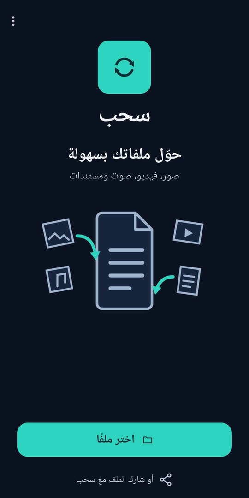
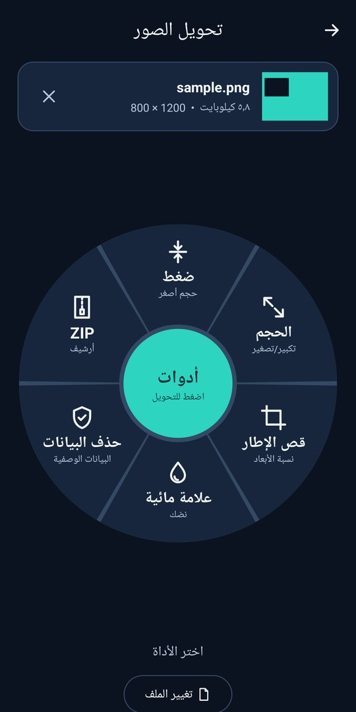
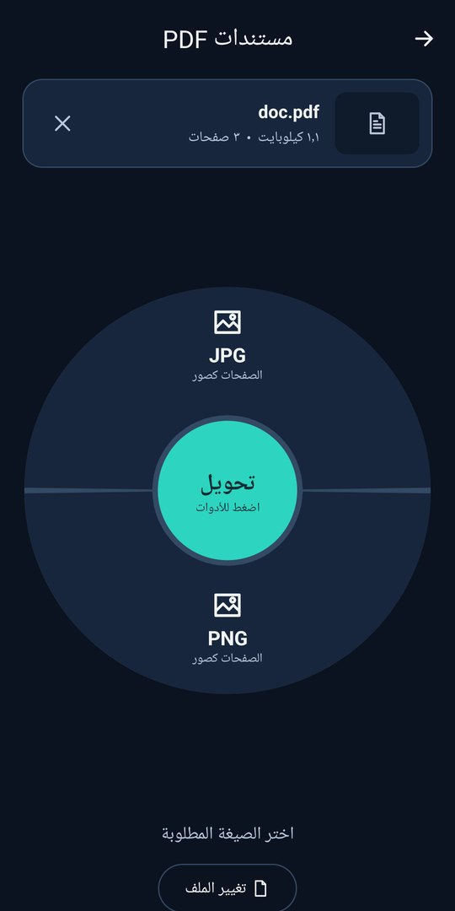

<h1 align="center">سحب — Sahb</h1>

حوّل الصور والفيديو والصوت وملفات PDF على جهازك مباشرة، بلا إنترنت وبلا رفع لملفاتك. 
تطوير: <b>طه مصطفى النفاتي</b> (Taha Mustafa Al-Nifati)

<a href="https://github.com/tahasodly-eng/Sahb/releases/latest/download/Sahb.apk"><b>⬇ تنزيل لأندرويد (APK)</b></a> ·
<a href="https://github.com/tahasodly-eng/Sahb/releases/latest/download/Setup_Sahb.exe"><b>⬇ تنزيل لويندوز</b></a> ·
<a href="https://tahasodly-eng.github.io/Sahb/">الموقع</a>

  

## المزايا
- **الصور:** تحويل إلى JPG أو PNG أو WEBP، أو جمعها في ملف PDF واحد.
- **الفيديو:** تحويل إلى MP4، استخراج الصوت، أو أخذ لقطة صورة.
- **الصوت:** تحويل واقتطاع.
- **PDF:** الصفحات إلى صور، دمج، استخراج صفحات، ضغط.
- **أدوات:** ضغط، تغيير الأبعاد، قص بنسب جاهزة، كتم الصوت، حذف البيانات المخفية، علامة مائية.
- **الخصوصية:** تطبيق أندرويد لا يملك إذن الإنترنت، ولا يجمع أي بيانات. انظر [سياسة الخصوصية](PRIVACY.md).

## ويندوز
اسحب أي ملف واضغط <kbd>Shift</kbd> أثناء السحب لتظهر دائرة الصيغ، وأضف <kbd>Ctrl</kbd> للأدوات، ثم أفلت الملف على ما تريد.

## التواصل
tahamnly2024@gmail.com
